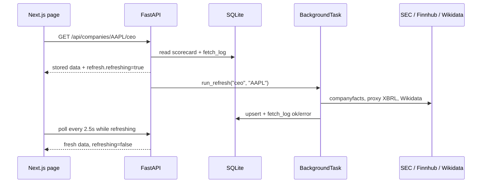

# Feature: Company Research - Profile, Price Chart, CEO Performance and News (Phase 2)

The research page at `/company/{TICKER}` shows a live quote, a candlestick chart compared with SPY, the company
profile and leadership, a **CEO performance scorecard**, and **news with sentiment**. Global presence and patents
are covered in the Phase 3 document.

## What was built

| Area | Files |
| --- | --- |
| Research API | `backend/app/api/routes/companies.py`, `backend/app/services/company.py` |
| Live quote (Finnhub) | `backend/app/providers/quotes_finnhub.py`, `finnhub_client.py` |
| News (Finnhub) and sentiment | `backend/app/providers/news_finnhub.py`, `backend/app/services/news.py`, `services/sentiment.py` |
| SEC EDGAR client + XBRL parser | `backend/app/providers/sec_edgar.py`, `providers/xbrl.py` |
| CEO tenure (Wikidata) | `backend/app/providers/wikidata.py` |
| CEO scorecard | `backend/app/services/ceo_scorecard.py` |
| Weekly research job | `backend/app/services/research_jobs.py` (registered in `scheduler.py`) |
| Migrations | `backend/alembic/versions/8537b4ea2b30_ceo_tenures.py`, `55980ed370b4_stock_splits.py` |
| UI | `frontend/components/company/*`, `frontend/app/company/[ticker]/page.tsx` |

## Request flow: stale-while-refresh

Research data changes slowly and free APIs are rate limited, so endpoints return what is stored **immediately**
and refresh in the background when the data is older than its time-to-live (TTL):



```python
# backend/app/services/refresh.py
def ensure_fresh(session, background, resource, ticker, source, ttl, fn, force=False) -> dict:
    stale = force or is_stale(session, resource, ticker, ttl)
    if stale and not is_refreshing(resource, ticker):
        background.add_task(run_refresh, resource, ticker, source, fn)
```

- TTLs: news 60 minutes, profile/CEO 7 days (from `.env`). Failures retry after 10 minutes.
- An in-memory set prevents duplicate concurrent refreshes of the same `(resource, ticker)`.
- The UI polls with TanStack Query's `refetchInterval` only while `refresh.refreshing` is true, and shows the last
  update time, errors, and a manual refresh button (`?force=true`).

## Live quote and chart

- `GET /api/companies/{t}/quote` calls Finnhub `/quote` (60 calls/min, header auth via `X-Finnhub-Token`), writes
  `quotes_latest`, and recomputes that ticker's swing metrics. Without a key it returns the stored, roughly 15-minute
  delayed Yahoo quote, and the header shows "Delayed (Yahoo)".
- `GET /api/companies/{t}/prices?range=1d|1w|1m|ytd|1y|5y` returns OHLC bars plus SPY bars for the same window.
  - 1M to 5Y come from `prices_daily`.
  - 1D and 1W use yfinance intraday bars (5 and 30 minute intervals), cached in memory for 5 minutes and not
    stored. If they are unavailable the endpoint falls back to daily bars.
- **lightweight-charts v5** (`chart.addSeries(CandlestickSeries, …)`) draws the candles. SPY is drawn as a line
  **rebased to the stock's first close**, so the gap between the two lines is the relative performance:

```ts
// frontend/components/company/chartData.ts
const factor = stock[0].close / aligned[0].close;
return aligned.map((b) => ({ time: b.time, value: Math.round(b.close * factor * 100) / 100 }));
```

## CEO scorecard

### Inputs

| Input | Source | Notes |
| --- | --- | --- |
| CEO name | yfinance `companyOfficers` | `pick_ceo()` prefers a company-level "CEO" title over subsidiary ones ("CEO of Specialty Insurance" at Berkshire) |
| Tenure start | Wikidata SPARQL: company `P5531` (SEC CIK) -> `P169` (CEO) with `P580`/`P582` qualifiers | Name matched on surname ("Tim" vs "Timothy" Cook) |
| Revenue, diluted EPS, net income | SEC `companyfacts` API (us-gaap) | Full-year 10-K values (330-400 day periods), de-duplicated by period end, latest filing wins |
| Pay vs performance | Latest DEF 14A **extracted XBRL instance** (`ecd` taxonomy) | `companyfacts` does **not** include `ecd` facts (verified: only `dei`, `us-gaap`, `ffd`) |
| Stock and SPY prices | `prices_daily.adj_close` | Total return over the tenure window |
| Split history | yfinance `Ticker.splits` -> `stock_splits` | Restates as-reported EPS to today's share basis |

```python
# Wikidata query (backend/app/providers/wikidata.py)
VALUES ?cik { "0000320193" "320193" }
?company wdt:P5531 ?cik .
?company p:P169 ?st . ?st ps:P169 ?ceo .
OPTIONAL { ?st pq:P580 ?start }  OPTIONAL { ?st pq:P582 ?end }
```

**Edge case found on live data:** Apple's newest CEO entry on Wikidata (from 2026-09-01) has no English label, so
the label comes back as the bare ID `Q106028933`. When no name matches, an *open* tenure with an unlabeled ID is
used and tagged `wikidata-unlabeled`; the UI asks the user to verify it.

### Metrics

- **Return vs SPY:** stock total return minus SPY total return since the later of the tenure start and the first
  stored bar. If the tenure predates the stored history (5 years), `window_truncated` is set and the UI says so.
  Annualized figures are included.
- **Revenue and EPS CAGR:** from the last fiscal year ending on or before the tenure start (the baseline) to the
  latest fiscal year. CAGR is computed only when both values are positive.
- **Split-adjusted EPS:** SEC values are as reported at filing time, so pre-split years are on an old share basis
  (NVIDIA's FY2019 diluted EPS was $6.63 as reported). Each EPS value is divided by the cumulative ratio of splits
  dated after its filing date:

```python
def split_factor(splits, as_of):              # backend/app/services/ceo_scorecard.py
    factor = 1.0
    for d, ratio in splits:
        if d > as_of:
            factor *= ratio
    return factor
```

  Found during a live UI review: before the fix NVIDIA's EPS CAGR showed 7.6%; after it, 32.1% (FY2019 EPS $0.166 on
  today's basis, after the 4:1 split in 2021 and the 10:1 split in 2024).
- **Net margin:** net income / revenue at the baseline year compared with the latest year.
- **Pay vs performance:** per fiscal year, the CEO's summary-table total compensation, compensation actually paid,
  the company TSR ($100 invested), the peer-group TSR, and net income, as disclosed under the SEC
  pay-versus-performance rule.

```python
# backend/app/services/ceo_scorecard.py
for f in facts:
    field = PVP_FIELDS.get(f.name)       # PeoTotalCompAmt, PeoActuallyPaidCompAmt, TotalShareholderRtnAmt, ...
    if field and f.prefix in ("ecd", "us-gaap") and not f.context.dims and f.context.end:
        rows[f.context.end][field] = to_float(f.value)
```

### Manual override

`PUT /api/companies/{t}/ceo {"ceo_name", "tenure_start"}` stores a `ceo_overrides` row and recomputes from stored
data (Wikidata tenures are saved in `ceo_scorecard.tenures`), so **no network calls** are made. A test enforces this.

### Live verification

| Ticker | CEO | Tenure source | Return vs SPY window | Revenue CAGR | Pay vs performance |
| --- | --- | --- | --- | --- | --- |
| AAPL | John Ternus | `wikidata-unlabeled` (2026-09-01) | since 2026-09-01 | 15.1% | FY2025: $74.3M total, $108.4M actually paid |
| MSFT | Satya Nadella | `wikidata` (2014-02-04) | truncated to stored history | 11.8% | FY2026: $90.6M total, $30.1M actually paid |

## News and sentiment

- `GET /api/companies/{t}/news` returns the last 30 days of Finnhub `/company-news` (de-duplicated by URL and
  pruned past 30 days), with a positive/neutral/negative summary and the average score.
- **FinBERT** (`ProsusAI/finbert`, via `transformers`) scores each headline plus summary locally. It is an optional
  extra (`uv sync --extra sentiment`), because PyTorch adds roughly 500 MB plus the model download.
- **VADER** is the automatic fallback when FinBERT is not installed. Scores are normalized to -1..+1: FinBERT uses
  P(positive) - P(negative); VADER uses its compound score with ±0.05 thresholds.
- Each article stores the model that scored it, shown in the badge tooltip.
- Verified with the real model: "Apple beats estimates and raises guidance" -> positive (+0.68); "Company faces SEC
  probe and shares plunge" -> negative (-0.93); "Annual meeting scheduled for March" -> neutral (-0.03).
- Without `FINNHUB_API_KEY`, the panel explains how to enable news; the refresh error is recorded in `fetch_log`.

## Technologies considered

| Decision | Chosen | Alternatives | Why |
| --- | --- | --- | --- |
| Chart | lightweight-charts v5 | Recharts, Highcharts | Proper financial candlesticks, small, canvas-based |
| CEO tenure | Wikidata + manual override | SEC 8-K Item 5.02 parsing, paid exec datasets | Free and structured; overrides cover gaps |
| Fundamentals | SEC companyfacts | yfinance financials (4 years only), FMP | Official, about 15 years of 10-K history |
| Pay vs performance | Proxy XBRL instance (`ecd`) | Scraping HTML proxy tables | Tagged data; the instance is easier than inline XBRL |
| XBRL parsing | lxml on the extracted instance | edgartools, Arelle | Small, testable, no heavy dependency; the instance has every context and dimension we need |
| Sentiment | FinBERT, falling back to VADER | Finnhub sentiment (paid), LLM API | Free, local, finance-tuned |
| News | Finnhub company-news | NewsAPI, RSS | Ticker-tagged, free tier |

## Tests

- Backend: `test_providers_research.py` (Finnhub quote/news parsing, filing index, Exhibit 21/instance discovery,
  companyfacts annual extraction checked against the 10-K's geographic sum, XBRL contexts, Wikidata), `test_sentiment.py`,
  `test_ceo_scorecard.py` (name matching, CEO resolution including the unlabeled case, pay-vs-performance parsing
  from Apple's real proxy instance, end-to-end refresh with fixtures, override without network, split factor and EPS
  restatement), `test_api_companies.py`
  (profile, price ranges with SPY, intraday fallback, live quote, news background refresh with sentiment, error
  reporting, CEO endpoint and override), `test_seed.py`.
- Fixtures under `backend/tests/fixtures/` are real, trimmed SEC and Wikidata responses for Apple.
- Frontend: `chartData.test.ts`, `company.test.tsx` (header plus live quote, chart series, CEO tab and override PUT,
  news filter, no-key hint, unknown ticker).
- End-to-end: `frontend/e2e/company.spec.ts` (screener -> research page, chart canvas and range switch, CEO
  override, news sentiment filter, breadcrumb back to the filtered screener, unknown ticker).
