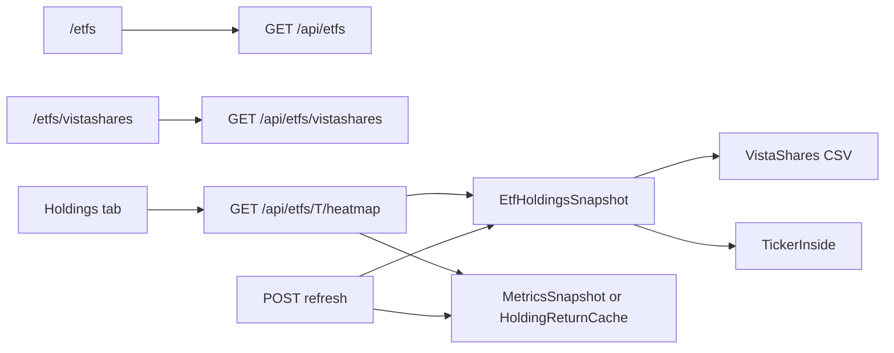

# Feature: ETF sections, VistaShares hub, and allocation heatmaps

Investar surfaces curated niche ETFs in a dedicated hub (`/etfs`), a VistaShares issuer section
(`/etfs/vistashares`), a home screener `browse=etfs` mode, and a Holdings tab on ETF company pages.
Maps use Finviz-style green/red heat colored by WoW / MoM / YoY (trailing 1W / 1M / 1Y).

## What was built

| Area | Files |
| --- | --- |
| Catalog | `backend/app/niches_catalog.py` (AIS, POW/electrification, RTOO, space, defense, income), `backend/app/vistashares_catalog.py` |
| Metrics | `chg_1m_*` / `chg_1y_*` on `MetricsSnapshot`; `backend/app/services/metrics.py`; migration `c8d4e5f6a7b8_…` |
| Holdings providers | `holdings_vistashares.py` (issuer CSV), `holdings_tickerinside.py`, `holdings_demo.py`; `registry.holdings(ticker)` |
| Cache + service | `EtfHoldingsSnapshot`, `HoldingReturnCache`; `backend/app/services/etfs.py` (TTL, top-25+Other, refresh) |
| API | `backend/app/api/routes/etfs.py` — list, VistaShares, heatmap, refresh |
| CLI | `investar load-etf-holdings [--ticker]` |
| Frontend hub | `components/etf/EtfHub.tsx`, `app/etfs/page.tsx`, `app/etfs/vistashares/page.tsx` |
| Treemap | `components/etf/Treemap.tsx` (Recharts), `PeriodToggle`, `heatColor.ts` |
| Company | Holdings tab via `HoldingsHeatmap.tsx` |
| Screener | `browse=etfs` in `screener/params.ts` + `Screener.tsx` |

## Data flow

### Holdings sources

- **VistaShares** tickers use `https://www.vistashares.com/etf/{ticker}/holdings.csv` (+ optional `data.json` for AUM).
- **Other curated ETFs** use TickerInside ` /api/v1/fund/{ticker}.json`.
- Offline / Playwright uses `DemoHoldings` when `OFFLINE_PROVIDERS=true`.

Holdings snapshots TTL ≈ 24h. Untracked holding returns are fetched on demand into `HoldingReturnCache`
(≈ 30 min) without adding those symbols to the screener universe.

### Heatmap rules

- ETF map tiles sized by AUM with a **2% of max** floor so small Supercycle funds stay visible.
- Holdings treemap: **top 25 equities** by weight; remaining equities + cash/options → **Other / overlays**.
- Period chips: **WoW / MoM / YoY** → `chg_1w_pct` / `chg_1m_pct` / `chg_1y_pct`.
- Manual **Refresh** on hub pages refreshes visible funds; company page refreshes that fund’s holdings + colors.

### Niche membership (dual-list)

| Fund | Niche |
| --- | --- |
| AIS | AI |
| POW | Energy Transition → Electrification |
| RTOO | Robotics |
| GALX | Space |
| AMMO | Defense |
| OMAH, ACKY, DRKY, TPRY, SIOO, QUSA, VOOB, QQQB | Income ETFs |

## Technologies considered

| Approach | Decision |
| --- | --- |
| yfinance fund holdings for everything | Rejected for VistaShares — issuer CSV is first-party and dated |
| Auto-track every holding | Rejected — pollutes universe; on-demand return cache instead |
| Custom canvas treemap | Recharts `Treemap` already in the stack; enough for Finviz-like maps |
| Separate `/etfs/[ticker]` research app | Rejected — extend `/company/[ticker]` with Holdings tab |

## Tests

- Backend: `tests/test_holdings.py`, `tests/test_api_etfs.py`, extended `test_metrics.py`
- Frontend: `__tests__/etfs.test.tsx`
- E2E: `e2e/etfs.spec.ts` (hub, VistaShares, holdings tab, screener ETFs mode)
