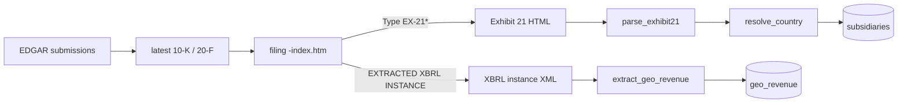

# Feature: Global Presence and Patents (Phase 3)

Two research-page tabs:

- **Global presence:** a world map of the countries where the company has significant subsidiaries (from the 10-K
  subsidiaries exhibit, Exhibit 21), a per-country list, revenue by region from the 10-K's XBRL data, and a
  searchable subsidiary list.
- **Patents:** granted patents over the last 10 years (counts per year, top technology areas, 50 most recent) and
  **upcoming** pending applications published in the last 24 months. Data comes from USPTO PatentsView via the API,
  or a manual bulk-file import when the API is unavailable.

## What was built

| Area | Files |
| --- | --- |
| Jurisdiction -> ISO country | `backend/app/services/countries.py` (pycountry + aliases + US states) |
| Exhibit 21 parser, revenue by region | `backend/app/services/global_presence.py` |
| PatentsView API client | `backend/app/providers/patents_patentsview.py` |
| Bulk TSV importer (fallback) | `backend/app/providers/patents_bulk.py`, `services/patents.py::import_bulk`, CLI `import-patents-bulk` |
| Patent service and assignee map | `backend/app/services/patents.py` |
| API | `GET /api/companies/{t}/global`, `GET /api/companies/{t}/patents`, `PUT /api/companies/{t}/patent-assignees` |
| Migration | `backend/alembic/versions/4a8b4188bc2c_geo_revenue_axis_and_country.py` |
| UI | `frontend/components/company/GlobalPresencePanel.tsx`, `PatentsPanel.tsx`, `public/maps/countries-110m.json` |

Both resources use the same stale-while-refresh flow as Phase 2: 7-day TTL, background refresh, `fetch_log` status,
UI polling, and weekly refresh via `research_jobs.WEEKLY_RESEARCH`.

## Global presence



### Subsidiaries (Exhibit 21)
- The filing index's **Type** column (`EX-21`, `EX-21.1`) locates the exhibit; file names vary too much to guess.
- `parse_exhibit21()` handles the common layouts:
  - tables (name | jurisdiction; header rows such as "Name / Where Incorporated" or "Organized Under The Laws Of"
    are skipped);
  - plain-text `Name (Jurisdiction)` and `Name – Jurisdiction` lines;
  - jurisdiction section headings (`Ireland:` followed by names).
- `resolve_country()` maps free text to ISO 3166:
  - US states, `U.S.` and `USA` map to the United States (so "Georgia" is the state; Exhibit 21 lists are US filings);
  - aliases cover England/Scotland -> GB, PRC -> CN, Korea -> KR, BVI, Türkiye, and others;
  - then a `pycountry` lookup per comma part, then a whole-word search over country names.
- The map uses the ISO **numeric** code, which matches world-atlas feature IDs (`"372"` = Ireland).
  Microstates missing from the 110m map (Hong Kong, Singapore, Luxembourg, Cayman…) are listed as "(not on map)".

### Revenue by region (XBRL)
SEC's `companyfacts` API only includes entity-wide facts, so revenue split by geography comes from the filing's
**extracted XBRL instance**:

```python
# backend/app/services/global_presence.py
if (f.prefix == "us-gaap" and f.name in REVENUE_CONCEPTS and len(dims) == 1 and axis_ok(next(iter(dims)))
        and (f.context.duration_days or 0) >= 330 and to_float(f.value) is not None):
```

- **Geographic disclosure:** `srt:StatementGeographicalAxis` (or the older `us-gaap:` axis). Members such as
  `country:US` become country names; custom members are humanized (`aapl:OtherCountriesMember` -> "Other Countries").
- **Geographic segments:** `us-gaap:StatementBusinessSegmentsAxis`, used only when **every** member looks
  geographic (Apple's Americas/Europe/Greater China...). Product segments are ignored. Segment facts also carry
  `srt:ConsolidationItemsAxis = OperatingSegmentsMember`, which is treated as neutral.
- Subtotal members ("Total International" at JPMorgan) are dropped to avoid double counting.
- All fiscal years in the filing (usually 3) are stored; the UI shows the latest, with shares of the total.
  When nothing is tagged the UI says "Not reported".

### Live verification

| Ticker | Subsidiaries (unmapped) | Countries | Revenue by region (latest FY) |
| --- | --- | --- | --- |
| AAPL | 20 (0) | 14 | Other countries 47.8%, US 35.0%, China 17.2%; segments Americas/Europe/Greater China/Japan/Rest of APAC |
| MSFT | 8 (0) | US, IE | US 51.5%, Non-US 48.5% |
| JPM | 18 (0) | US, GB, LU, DE, IN, JP… | North America 76.6%, EMEA 13.4%, Asia Pacific 7.7%, Latin America 2.3% |

## Patents

### Assignee mapping
Patents are owned by legal entities, not tickers. `patent_assignee_map` holds the names searched per company:

- **Curated** names for well-known cases: Alphabet -> "Google LLC", "Google Inc.", "Waymo LLC"; Meta -> "Meta
  Platforms, Inc.", "Facebook, Inc."; Microsoft -> "Microsoft Technology Licensing, LLC"; Amazon -> "Amazon
  Technologies, Inc."; and others.
- **Automatic** names for the rest: the exact listed name plus a **prefix** match on `"<core name> "`. The trailing
  space keeps "Apple " from matching "Applied Materials".
- **Manual** edits from the UI (`PUT /patent-assignees`), which trigger a forced refresh.

### API path (PatentsView PatentSearch)
Field names come from the official OpenAPI spec (`PatentsView/PatentSearch-API`):

```python
# 10 cheap count queries (size=1 -> total_hits), one per year
{"q": {"_and": [assignee_clause, {"_gte": {"patent_date": "2017-01-01"}}, {"_lte": {"patent_date": "2017-12-31"}}]},
 "f": ["patent_id"], "o": {"size": 1}}
# 1 query for the 1,000 most recent grants (CPC breakdown + 50 kept for the list)
{"f": ["patent_id", "patent_title", "patent_abstract", "patent_date", "assignees.assignee_organization",
       "cpc_current.cpc_subclass_id"], "s": [{"patent_date": "desc"}], "o": {"size": 1000}}
# 1 query on /publication/ for pre-grant applications in the last 24 months
```

- 12 requests per company, under the 45 requests/minute limit (the client allows 40/min).
- Auth uses the `X-Api-Key` header. A missing key, connection error or 401/403 raises `PatentsViewUnavailable`,
  which is a `ProviderUnavailable`: it is logged as a warning (no traceback), stored in `fetch_log`, and shown in
  the UI with the bulk-import hint.
- **Status today:** `search.patentsview.org` did not respond during development, consistent with USPTO's notice
  that the API is migrating to the Open Data Portal with outages expected. Hence the fallback below.

### Bulk fallback (manual)
Download the PatentsView tables from the USPTO Open Data Portal (`data.uspto.gov/bulkdata`) into one folder:

| Set | Files |
| --- | --- |
| Granted | `g_patent`, `g_assignee_disambiguated`, optional `g_cpc_current`, optional `g_patent_abstract` |
| Pre-grant | `pg_published_application`, `pg_assignee_disambiguated`, optional `pg_cpc_current` |

```bash
uv run investar import-patents-bulk ~/Downloads/patentsview            # all companies
uv run investar import-patents-bulk ~/Downloads/patentsview --tickers AAPL NVDA
```

- Files (`.tsv` or `.tsv.zip`) are streamed in 500k-row pandas chunks. Assignee tables are matched first, then only
  the matching documents are read from the large patent tables.
- Counts are exact, because every record is local; the CPC class with the lowest `cpc_sequence` is kept per patent.
- Column names are detected flexibly (`patent_id`/`pgpub_id`, `patent_title`/`application_title`, …) to survive
  release-to-release changes.

### Display
- KPIs: granted in the last 10 years, applications published in the last 24 months.
- Grants per year (Recharts), top CPC technology areas with readable titles (G06F "Electric digital data
  processing", G06N "AI and machine learning", …), and lists linking to Google Patents (`US{number}`,
  `US{number}A1` for applications), with expandable abstracts.

## Technologies considered

| Decision | Chosen | Alternatives | Why |
| --- | --- | --- | --- |
| Subsidiary source | 10-K Exhibit 21 | OpenCorporates, LEI (GLEIF) relationships | Official, free, per-filing; GLEIF coverage is uneven |
| Revenue by region | XBRL instance (dimensional facts) | companyfacts (no dimensions), HTML table scraping | Tagged values; one parser for all filers |
| Country mapping | pycountry + aliases | hand-written table, geocoding API | ISO data offline; aliases cover filing conventions |
| Map | react-simple-maps v5 + world-atlas 110m (served locally) | Leaflet/Mapbox tiles, D3 directly | Lightweight SVG choropleth, no tile server or token |
| Patents | PatentsView API + bulk TSV fallback | Google Patents BigQuery, scraping | Free and official; bulk covers the API migration |
| Assignee matching | curated + exact + "core " prefix, user-editable | fuzzy matching across all assignees | Predictable, explainable, few false positives |

## Tests

- `backend/tests/test_global_presence.py`: 22 jurisdiction cases, Exhibit 21 table and text layouts, header and
  subtotal skipping, member humanizing, revenue by region from Apple's real 10-K instance (geographic + segments,
  3 fiscal years), product segments excluded, refresh + payload (country counts, shares sum to 100%, filing link),
  endpoint.
- `backend/tests/test_patents.py`: core names and default assignees, query JSON, API payload parsing, missing key,
  unreachable API and success (respx mock), refresh + payload with a fake API, assignee editing, prefix matcher not
  over-matching, **bulk import** from generated TSV and zipped TSV files (date windows, CPC sequence, abstracts
  file, applications), endpoints, API-down error surfacing.
- `backend/tests/test_migrations.py`: upgrading a database that already has `geo_revenue` rows (the new NOT NULL
  `axis` column has a server default).
- `frontend/__tests__/phase3.test.tsx`: map fills and "(not on map)", revenue table and axis switch, subsidiary
  filter, "Not reported", patents KPIs/lists/links, assignee add -> PUT body, API-down message.
- `frontend/e2e/research-global-patents.spec.ts`: real map rendering (>100 country paths, Ireland highlighted),
  revenue table, patents lists and assignee editing, empty states.
