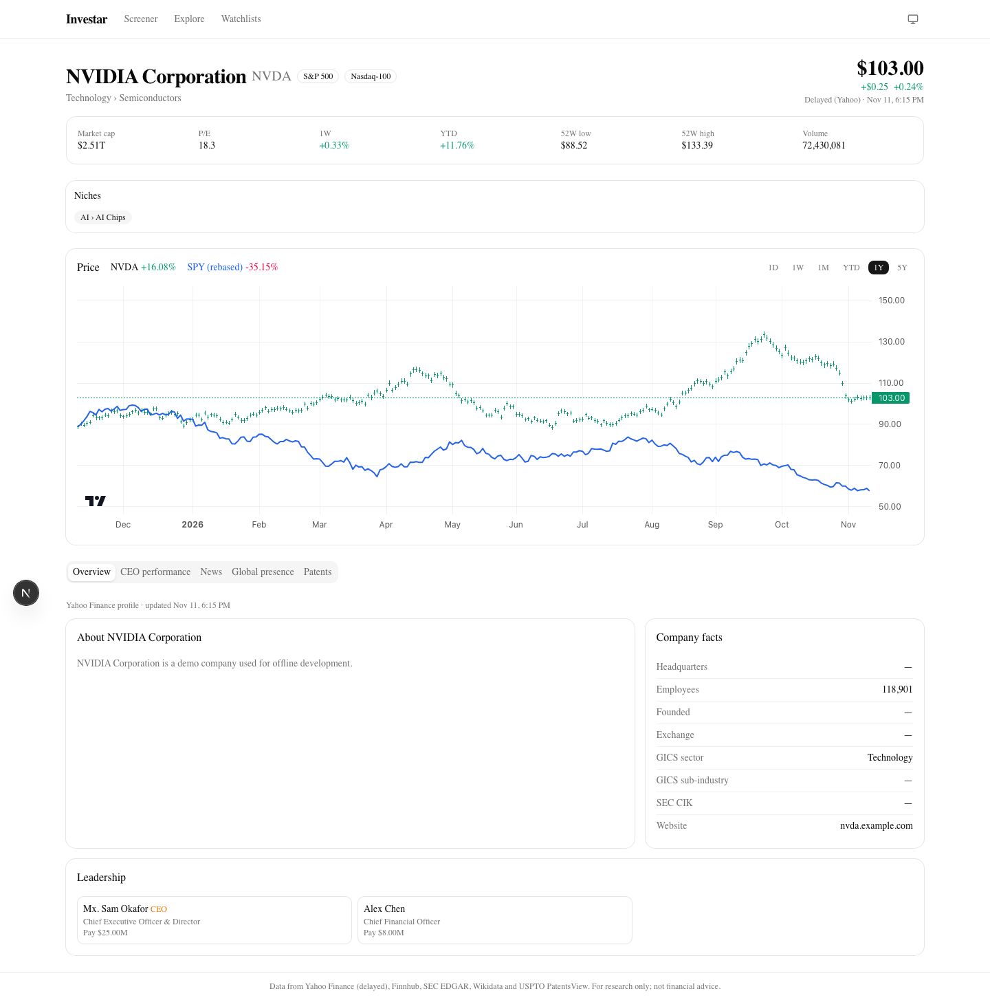
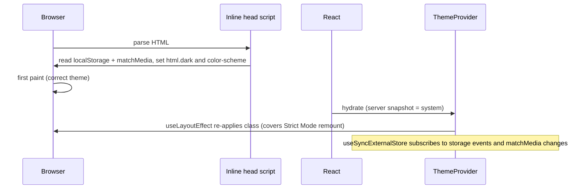

# Feature: Light and Dark Theme

A theme menu in the header offers **System**, **Light** and **Dark**. System is the default and follows the
operating system's `prefers-color-scheme`, including live changes. An explicit choice is saved in `localStorage`
and survives reloads. Charts, the subsidiary map and accent colors all switch with the theme.



## What was built

| Area | Files |
| --- | --- |
| Pre-paint script (no flash) | `frontend/lib/themeScript.ts`, injected in `frontend/app/layout.tsx` |
| Theme state | `frontend/lib/theme.ts` (`useTheme`, `setThemePreference`, `applyTheme`) |
| Provider | `frontend/components/theme/ThemeProvider.tsx` (wired in `app/providers.tsx`) |
| Header menu | `frontend/components/theme/ThemeToggle.tsx` (shadcn/Base UI dropdown, radio items) |
| Chart palettes | `frontend/lib/chartTheme.ts` (`CHART_COLORS`, `useChartColors`) used by `PriceChart`, `PatentsPanel`, `CeoScorecardPanel`, `GlobalPresencePanel` |
| Text accents | `text-emerald-600 dark:text-emerald-400` style pairs across `ChangeValue`, `Sparkline`, `NewsPanel`, `RefreshNote`, alerts |

The design tokens already existed: `globals.css` defines light values on `:root` and dark values on `.dark`
(shadcn's neutral palette). The app previously hardcoded `class="dark"` on `<html>`; that was removed.

## How it works



1. **Before first paint**, an inline `<script>` in `<head>` reads the stored preference and the OS setting and sets
   the `dark` class and `color-scheme` on `<html>`. `<html suppressHydrationWarning>` tells React to accept that
   attribute change. This is the pattern in Next 16's "Preventing flash before hydration" guide.

```ts
// frontend/lib/themeScript.ts
export const THEME_INIT_SCRIPT = `(function(){try{var p=localStorage.getItem("${THEME_STORAGE_KEY}");var d=p==="dark"||(p!=="light"&&window.matchMedia("${DARK_QUERY}").matches);var r=document.documentElement;r.classList.toggle("dark",d);r.style.colorScheme=d?"dark":"light"}catch(e){}})()`;
```

2. **After hydration**, `useTheme()` reads two external stores with `useSyncExternalStore`: the saved preference
   (with a `storage` listener, so other tabs stay in sync) and the OS setting (`matchMedia` `change` listener).
   Using server snapshots (`"system"`, `"light"`) avoids hydration mismatches in the toggle's label.

```ts
// frontend/lib/theme.ts
export function useTheme() {
  const preference = useSyncExternalStore(subscribePreference, readPreference, () => "system" as const);
  const system = useSyncExternalStore(subscribeSystem, readSystemTheme, () => "light" as const);
  return { preference, resolved: resolveTheme(preference, system), setPreference: setThemePreference };
}
```

3. `ThemeProvider` applies the resolved theme in a `useLayoutEffect`. That also re-applies it after React Strict
   Mode's development remount, which resets attributes on `<html>`. Later changes briefly disable CSS transitions so
   colors switch at once.
4. Choosing **System** removes the stored key, so the app follows the OS again.

### Charts

The libraries take colors as values, not CSS classes, so `useChartColors()` returns a palette for the resolved theme:

```ts
// frontend/lib/chartTheme.ts (excerpt)
light: { axis: "#525252", grid: "rgba(0,0,0,0.08)", up: "#059669", down: "#e11d48", benchmark: "#2563eb", ... },
dark:  { axis: "#a3a3a3", grid: "rgba(255,255,255,0.06)", up: "#34d399", down: "#fb7185", benchmark: "#60a5fa", ... },
```

- **lightweight-charts** (`PriceChart`): the chart is created once per data load. A separate effect calls
  `chart.applyOptions` and `series.applyOptions` when the palette changes, so switching themes doesn't rebuild the
  chart or reset zoom.
- **Recharts** (patents, CEO pay): grid, axis, tooltip and bar colors come from the palette.
- **react-simple-maps**: `fillFor(count, max, colors)` mixes the theme's map color with a per-country alpha; empty
  countries and borders use theme-appropriate translucent black or white.

## Technologies considered

| Option | Verdict |
| --- | --- |
| `next-themes` 0.4.6 | Considered first (supports React 19). It renders its init `<script>` from a client component, which React 19 reports as "Encountered a script tag while rendering React component" in development (shown in the Next dev overlay). The Next 16 docs recommend an inline `<head>` script plus `useLayoutEffect` instead, which is about 100 lines with no dependency. |
| Cookie plus server-read theme | Would make the root layout dynamic (no static prerendering) for a purely cosmetic preference |
| CSS-only `@media (prefers-color-scheme)` | Can't support a manual override |
| Chart colors from CSS variables at runtime | lightweight-charts needs concrete colors and doesn't react to CSS changes; a typed palette is simpler and testable |

## Tests

- Vitest `__tests__/theme.test.tsx`: preference parsing, resolution, the inline script, the provider following
  OS changes, manual override and persistence, the dropdown's three options, and `useChartColors` switching.
  `__tests__/phase3.test.tsx` checks the map palette in both themes.
- Playwright `e2e/theme.spec.ts`: an emulated `colorScheme` drives the default; Light survives a reload and
  overrides a dark OS; switching to System follows the OS again; no hydration or script-tag console errors.

Results are saved in `docs/test-artifacts/`.
