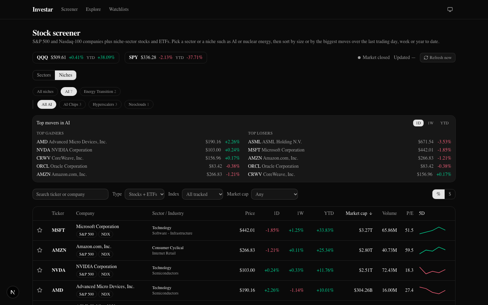
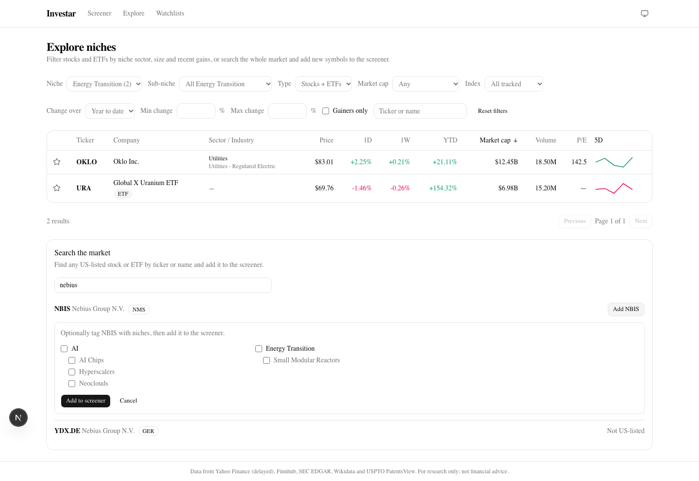
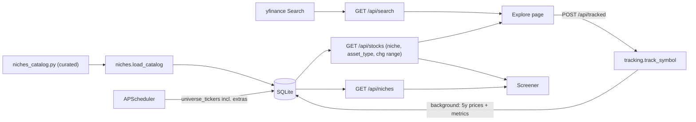
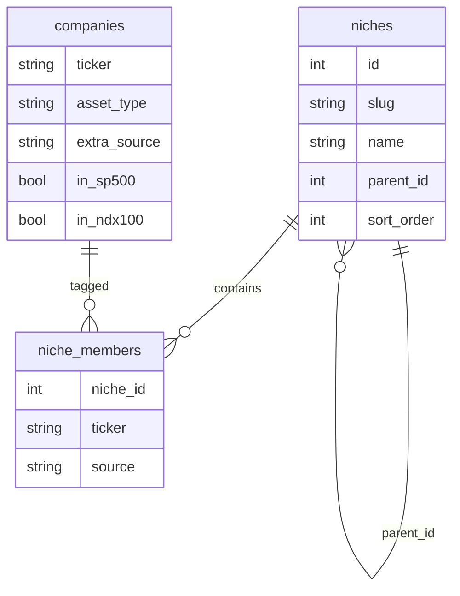

# Feature: Niche Sectors and the Explore Page

Adds thematic **niches** that cut across Yahoo's sectors (AI, hyperscalers, neoclouds, nuclear energy, quantum,
robotics, cybersecurity) and widens the tracked universe beyond the S&P 500 and Nasdaq-100 to the stocks and ETFs
those niches need (CoreWeave, Nebius, Oklo, Cameco, URA...).

- **Screener:** a "Browse by: Sectors | Niches" switch. Niches use the same two-level chips as sectors (niche, then
  sub-niche); the stock table and top movers follow the selection. New filters: Stocks/ETFs and "Not in an index".
- **Explore page (`/explore`):** filter by niche, sub-niche, asset type, market cap band, index, and gain range
  (1D / 1W / YTD with min and max %, "gainers only"), plus a **market search** that finds any US-listed stock or ETF
  on Yahoo and adds it to the screener, optionally tagged with niches.
- **Company page:** niche badges (linking to the filtered screener), editing your own tags, "Stop tracking" for
  symbols you added, and a simpler ETF page (no CEO, global presence or patents tabs).




## Decisions (from the design interview)

| Question | Decision |
| --- | --- |
| Stock universe | Expand: curated niche stocks and ETFs outside the indexes also show in the main screener |
| Who decides membership | A curated catalog in the repo; users may tag only symbols they added; curated tags are locked |
| Hierarchy | Two levels (parent niche > sub-niche), mirroring sector > industry |
| Starting niches | AI (AI Chips, Hyperscalers, Neoclouds, AI Networking and Data Center, AI Software), Energy Transition (Nuclear Operators, Small Modular Reactors, Uranium and Fuel), Quantum Computing, Robotics, Cybersecurity |
| Screener UI | Sectors / Niches switch; movers follow the selection |
| Index filter | "All tracked" covers everything; new "Not in an index" option |
| ETFs | `asset_type` column, Stocks/ETFs filter, simplified company page |
| Explore | Local filters + live Yahoo search; "add" = track (profile, 5y prices, metrics) and optionally tag |
| Which symbols can be added | US-listed (NYSE, Nasdaq, NYSE American, NYSE Arca, Cboe BZX), USD-priced stocks and ETFs |
| Add flow | Background: the row shows "Adding…" and fills in when prices arrive |

## What was built

| Area | Files |
| --- | --- |
| Curated catalog | `backend/app/niches_catalog.py` |
| Schema + migration | `Niche`, `NicheMember`, `Company.asset_type`, `Company.extra_source` in `backend/app/models/market.py`; `backend/alembic/versions/b7c1d2e3f4a5_niches_and_extra_universe.py` |
| Catalog loading, tree, tagging | `backend/app/services/niches.py` |
| Universe + niche SQL helpers | `backend/app/services/universe.py` |
| Screener filters | `backend/app/services/screener.py`, `backend/app/api/routes/market.py` |
| Search + tracking | `backend/app/providers/search_yfinance.py`, `backend/app/services/tracking.py`, `backend/app/api/routes/niches.py` |
| Offline demo providers | `backend/app/providers/demo.py` (`OFFLINE_PROVIDERS=true`) |
| Ingest | `ingest.fill_ciks`, `ingest.fetch_new_symbols`, `universe_tickers` now includes extras; `research_jobs.research_tickers` skips ETFs and non-SEC symbols |
| CLI | `uv run investar load-niches [--no-fetch]`; `bootstrap` loads niches; `seed-demo` adds CRWV, OKLO, URA |
| Screener UI | `components/screener/TwoLevelPicker.tsx`, `NichePicker.tsx`, `SectorPicker.tsx`, `Screener.tsx`, `FilterBar.tsx`, `MoversPanel.tsx`, `StocksTable.tsx`, `params.ts` |
| Explore UI | `app/explore/page.tsx`, `components/explore/Explore.tsx`, `MarketSearch.tsx`, `params.ts` |
| Tagging UI | `components/niches/NicheChecklist.tsx`, `components/company/NichesCard.tsx`, `CompanyResearch.tsx`, `CompanyHeader.tsx` |

## Architecture



## Data model



- `companies.asset_type`: `stock` or `etf` (default `stock`, so existing rows migrate unchanged).
- `companies.extra_source`: why a symbol is tracked beyond the indexes: `curated` (in the catalog) or `user`
  (added from Explore). Null means "index member only".
- `niche_members.source`: `curated` rows are owned by the catalog; `user` rows by the user. Members can sit on a
  parent (broad theme ETFs such as AIQ, URA) or a sub-niche.

The tracked universe is one SQL expression shared by the screener, the scheduler and the niche tree:

```python
# backend/app/services/universe.py
def in_universe():
    """Index members plus curated and user-added extras (benchmarks are filtered separately)."""
    return Company.in_sp500 | Company.in_ndx100 | Company.extra_source.is_not(None)


def niche_member_tickers(slug: str):
    """Subquery of tickers in a niche, including its sub-niches."""
    target = select(Niche.id).where(Niche.slug == slug).scalar_subquery()
    ids = select(Niche.id).where(or_(Niche.id == target, Niche.parent_id == target))
    return select(NicheMember.ticker).where(NicheMember.niche_id.in_(ids))
```

## The curated catalog

```python
# backend/app/niches_catalog.py (excerpt)
NicheSpec(
    "energy-transition", "Energy Transition", "Low-carbon power generation and its fuel supply chain.",
    etfs=("URA", "NLR"),
    children=(
        NicheSpec("nuclear-operators", "Nuclear Operators", "...", stocks=("CEG", "VST", "TLN")),
        NicheSpec("small-modular-reactors", "Small Modular Reactors", "...", stocks=("OKLO", "SMR", "NNE", "BWXT", "GEV")),
        NicheSpec("uranium-fuel", "Uranium and Fuel", "...", stocks=("CCJ", "LEU", "UEC", "UUUU", "NXE", "DNN"), etfs=("URNM",)),
    ),
),
```

`load_catalog()` is idempotent: it upserts niches by slug, deletes niches no longer listed, syncs `curated`
memberships, marks catalog tickers `extra_source="curated"` (creating placeholder companies for new ones) and,
for tickers dropped from the catalog, falls back to `user` (if the user tagged them) or null (leaves the universe).
User rows are never touched. It returns the new tickers so `load-niches` can fetch their CIK, profile and 5 years of
prices.

To change the catalog: edit `niches_catalog.py`, then `uv run investar load-niches`.

## API

| Endpoint | Purpose |
| --- | --- |
| `GET /api/niches` | Tree with counts; a parent's count is the union of its own and its children's members |
| `GET /api/stocks?niche=&asset_type=&index=other&chg_window=&chg_min=&chg_max=` | New screener filters (change bounds are percent) |
| `GET /api/movers?niche=` | Top movers within a niche |
| `GET /api/search?q=` | Yahoo symbol search with `us_listed`, `asset_type`, `tracked` and `addable` flags |
| `POST /api/tracked {ticker, niche_ids}` | Validate and track a symbol (202); prices load in the background |
| `GET /api/tracked/{ticker}/status` | `adding`, `ready` or `error` (from `fetch_log` resource `track`) |
| `DELETE /api/tracked/{ticker}` | Stop tracking (409 for curated or index symbols) |
| `PUT /api/companies/{ticker}/niches {niche_ids}` | Replace user tags on a user-added symbol |

### Tracking flow

```python
# backend/app/services/tracking.py (excerpt)
p = registry.profiles().profile(t)               # one Yahoo call, synchronous (~1 s)
asset_type = ASSET_TYPES.get(p.quote_type or "")  # EQUITY -> stock, ETF -> etf, else 422
if p.exchange not in US_EXCHANGES: raise TrackError(422, "... only US-listed symbols can be added")
if (p.currency or "").upper() != "USD": raise TrackError(422, "... only USD symbols can be added")
comp.extra_source, comp.asset_type = "user", asset_type
```

The route then schedules `backfill_tracked` (CIK lookup, 5 years of daily bars, metrics) with the existing
`run_refresh` helper, so failures land in `fetch_log` and the UI's status poll shows them inline. Yahoo symbols are
kept verbatim (`SHOP.TO` stays dotted) because search results already use Yahoo's format.

## UI

- `TwoLevelPicker` generalizes the old sector chips; `SectorPicker` and `NichePicker` are thin wrappers, so existing
  accessible names ("Sector Technology", "Industry Semiconductors") are unchanged and niches get "Niche AI",
  "Sub-niche Neoclouds". Niche counts are not summed into an "All" total because niches overlap.
- Screener URL state gains `browse`, `niche`, `sub` and `type`; switching browse modes clears both pickers.
- Explore keeps every filter in the URL (`niche`, `sub`, `type`, `cap`, `index`, `window`, `min`, `max`, `gainers`,
  `q`, `sort`, `order`, `page`). "Gainers only" raises the minimum to 0%:

```ts
// frontend/components/explore/params.ts
const min = s.gainers ? Math.max(s.min ?? 0, 0) : s.min;
const ranged = min !== undefined || s.max !== undefined;
return { niche: s.sub ?? s.niche, chg_window: ranged ? s.window : undefined, chg_min: min, chg_max: s.max, ... };
```

- `MarketSearch` debounces input (300 ms), explains why a result can't be added ("Not US-listed",
  "Only stocks and ETFs", "Already tracked"), and after adding polls `/api/tracked/{t}/status` every 2 s until ready,
  then refreshes the stock, niche, sector and mover queries once.

## Technologies considered

| Choice | Picked | Alternatives and why not |
| --- | --- | --- |
| Membership source | Curated Python catalog | Keyword rules on descriptions (noisy: "AI" appears everywhere); copying ETF holdings (needs a paid holdings feed; drifts); YAML (adds a dependency for no benefit) |
| Data model | Separate `niches` + `niche_members` tables | Reusing `sector`/`industry` columns (one value per company, but MSFT is both AI and a hyperscaler) |
| Market search | `yfinance.Search` (already a dependency) | Finnhub `/search` (needs an API key, no quote type for ETFs); SEC `company_tickers.json` (no ETFs) |
| Validation data | `Ticker.info` (`quoteType`, `exchange`, `currency`) | Trusting search results (they lack currency) |
| Add flow | FastAPI `BackgroundTasks` + `fetch_log` | A job queue (Celery/RQ): overkill for a local single-user app |
| E2E determinism | `OFFLINE_PROVIDERS=true` demo providers | Network calls in Playwright (flaky); route mocking in the browser (wouldn't exercise the backend) |

## Tests

- Backend (`uv run pytest`): `tests/test_niches.py` (idempotent load, union counts, user tags survive reloads,
  removed curated symbols leave the universe, real catalog shape, research skips ETFs/non-SEC),
  `tests/test_api_niches.py` (niche/asset/index/change filters, movers, search flags, tracking success and every
  rejection, background failure, untrack rules, tag editing, offline providers), `tests/test_migrations.py`
  (upgrade defaults, downgrade), `tests/test_providers_market.py` (profile identity fields).
- Frontend (`pnpm test`): `__tests__/niches.test.tsx` (picker, URL state, Screener niches mode, badges),
  `__tests__/explore.test.tsx` (URL state, filters, add flow, error display, ETF and user-added company pages).
- End-to-end (`pnpm e2e`): `e2e/explore.spec.ts` (browse niches, Explore filters, search + add + stop tracking,
  ETF page). Existing screener counts were updated for the three demo extras.

Results are saved in `docs/test-artifacts/`.
