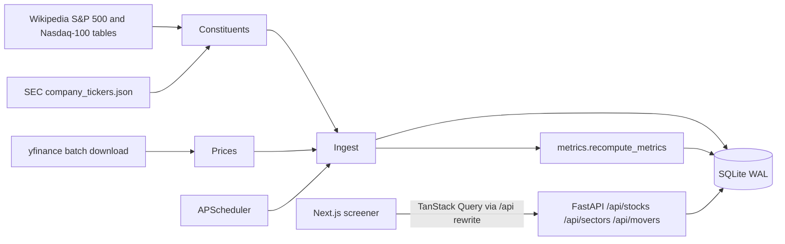

# Feature: Screener and Market Data (Phase 1)

Lets a user pick a **sector** and then an **industry**, and see the related S&P 500 and Nasdaq-100 stocks sorted by
market cap or by the largest positive or negative swings since the last trading day, over the trading week, and
year to date (YTD). It also shows top movers per sector, SPY and QQQ benchmarks, and saved watchlists.

## What was built

| Area | Files |
| --- | --- |
| Stock list (S&P 500 + Nasdaq-100) | `backend/app/providers/constituents.py`, `backend/app/services/ingest.py::load_universe` |
| Prices and profiles (yfinance) | `backend/app/providers/prices_yfinance.py` |
| Swing metrics | `backend/app/services/metrics.py` |
| Screener queries | `backend/app/services/screener.py` |
| Scheduler (15 min intraday, end-of-day, weekly) | `backend/app/scheduler.py`, `backend/app/services/market_hours.py` |
| Freshness tracking | `backend/app/services/refresh.py`, `fetch_log` table |
| REST API | `backend/app/api/routes/market.py`, `watchlists.py`, `admin.py` |
| SQLite schema and migrations | `backend/app/models/`, `backend/alembic/versions/` |
| Screener UI | `frontend/components/screener/*`, `frontend/app/page.tsx` |
| Watchlists UI | `frontend/components/watchlists/*`, `frontend/app/watchlists/page.tsx` |

## Architecture



## Data sources and how they are used

### Stock list
- **S&P 500:** Wikipedia "List of S&P 500 companies" table (ticker, name, GICS sector and sub-industry, HQ, CIK).
- **Nasdaq-100:** Wikipedia "List of NASDAQ-100 companies" (this table moved off the main Nasdaq-100 article;
  the parser looks for any 90+ row table with a `Ticker` or `Symbol` column so it tolerates layout changes).
- **CIK numbers:** SEC `company_tickers.json` fills CIKs for Nasdaq-100-only members.
- Tickers are stored in Yahoo format (`BRK-B`). `to_dotted()` converts for Finnhub (`BRK.B`).
- A live run loaded **518 companies**: 86 in both indexes and 15 Nasdaq-100-only, every one with a CIK.

```python
# backend/app/services/ingest.py
for r in rows:
    m = merged.setdefault(r.ticker, {"ticker": r.ticker, "name": r.name, "in_sp500": False, "in_ndx100": False})
    m["in_sp500"] |= r.index == "sp500"
    m["in_ndx100"] |= r.index == "ndx100"
```

Companies that leave both indexes keep their rows (history is preserved) but get `in_sp500 = in_ndx100 = False`, so
the screener stops showing them.

### Prices
- `yf.download(chunk, period=..., interval="1d", group_by="ticker")` in chunks of 100 tickers.
- **Backfill:** 5 years of daily bars (about 650,000 rows for the full universe).
- **Intraday refresh:** `period="5d"`. During market hours the last daily bar is the in-progress (about 15 minute
  delayed) session, so one batched call refreshes every ticker. The partial bar is upserted and overwritten by the
  end-of-day snapshot.
- yfinance's internal timezone cache sometimes raises `database is locked` under threaded downloads, so any ticker
  missing from a batch is retried serially.

### Sector and industry
- Main filter: **Yahoo sector and industry** (from `Ticker.info`), consistent across both indexes.
- **GICS** sector and sub-industry from Wikipedia are stored alongside (`gics_sector`, `gics_sub_industry`) and used
  as a fallback until a Yahoo profile is fetched.

## Swing calculation

`compute_swings()` is a pure function, fully unit tested:

```python
# backend/app/services/metrics.py
week_start = latest_date - timedelta(days=latest_date.weekday())
week_ref = _last_before(closes, week_start)               # last close of the previous trading week
ytd_ref = _last_before(closes, date(latest_date.year, 1, 1))  # last close of the previous year
d_pct, d_abs = _change(price, prev_close)                 # previous session close
```

- The **current price** comes from `quotes_latest` when it is at least as new as the latest bar; otherwise the
  latest close is used.
- Holidays need no special handling: references are taken from actual trading-day bars in `prices_daily`.
- Market cap is recomputed as `shares_outstanding * price` so it moves with the intraday price.
- Each snapshot stores percentage and dollar changes, the 52-week range and the last 5 closes for the sparkline.

## Scheduler

```python
# backend/app/scheduler.py
s.add_job(intraday_job, IntervalTrigger(minutes=15), id="intraday", max_instances=1, coalesce=True)
s.add_job(eod_job, CronTrigger(day_of_week="mon-fri", hour=16, minute=20, timezone=NY), id="eod")
s.add_job(weekly_job, CronTrigger(day_of_week="sun", hour=2, minute=0, timezone=NY), id="weekly")
```

- `intraday_job` only runs when `exchange_calendars` (XNYS) says the market is open, which handles early closes and
  holidays.
- `weekly_job` reloads the stock list and profiles, then runs the research hooks added in phases 2 and 3.
- The manual **Refresh now** button calls `POST /api/refresh {"scope": "prices"}`, which runs the same job as a
  FastAPI background task. `GET /api/status` reports progress so the UI can poll and then reload the table.

## API

| Endpoint | Purpose |
| --- | --- |
| `GET /api/sectors` | Sector -> industry tree with counts |
| `GET /api/stocks?sector&industry&index&cap_band&q&watchlist_id&sort&order&mode&page&page_size` | Screener page |
| `GET /api/movers?sector&industry&window&mode&limit` | Top gainers and losers |
| `GET /api/benchmarks` | SPY and QQQ rows |
| `POST /api/refresh`, `GET /api/status` | Manual refresh and job status |
| `/api/watchlists` (GET/POST), `/{id}` (PUT/DELETE), `/{id}/items` (POST), `/{id}/items/{ticker}` (DELETE) | Watchlists |

Sorting is done on the server against a whitelist (`sort_column()`); `mode=abs` switches swing sorts from the
`*_pct` to the `*_abs` columns. FastAPI `Literal` types reject unknown sort keys with a 422.

## Frontend

- **Next.js 16 App Router**, client components with **TanStack Query**; `next.config.ts` rewrites `/api/*` to FastAPI
  (default `http://127.0.0.1:8010`, override with `INVESTAR_API_ORIGIN`).
- Screener state (sector, industry, index, cap band, search, watchlist, sort, order, %/$ mode, movers window, page)
  lives in the **URL**, so views are shareable and survive reloads (`components/screener/params.ts`).
- The table uses **TanStack Table v9** (`useTable`, typed column helper, `table.FlexRender`).

```tsx
// v9 keeps column definitions stable, so per-render inputs (the %/$ mode, watchlists) reach cells via context
const CellContext = createContext<{ mode: ChangeMode; watchlists: Watchlist[] }>({ mode: "pct", watchlists: [] });
function ChangeCell({ row, window }: { row: StockRow; window: SwingWindow }) {
  const { mode } = useContext(CellContext);
  return <ChangeValue value={row[`${window}_${mode}`]} mode={mode} />;
}
```

An end-to-end test caught this: cells built in a `useMemo` that depended on `mode` stayed stale after toggling.

- Filters use styled native `<select>` elements, so they are accessible and easy to drive in tests. Buttons, cards,
  badges, inputs and the table come from **shadcn/ui** (Base UI flavour).
- Sparklines are a small dependency-free SVG component.

## Technologies considered

| Decision | Chosen | Alternatives considered | Why |
| --- | --- | --- | --- |
| Prices | yfinance (free, delayed) behind `PriceProvider` | Finnhub (candles are paid), Polygon/FMP (paid) | Free batch download covers about 520 tickers in one call; the provider interface allows a paid swap |
| Live quotes | Finnhub `/quote` (phase 2, research page) | Polling Finnhub for all tickers | 60 calls/min would take about 9 minutes per refresh for 520 tickers |
| Constituents | Wikipedia tables + SEC CIK map | ETF holdings files (SSGA, Invesco) | Wikipedia has GICS columns and needs no file-format parsing |
| Taxonomy | Yahoo sector/industry, GICS stored | GICS only, toggle | Yahoo covers every ticker consistently; GICS is missing for Nasdaq-100-only names |
| Scheduler | APScheduler in-process | Celery/RQ, cron | Single-user local app; no broker needed |
| Market calendar | exchange_calendars (XNYS) | pandas_market_calendars, hand-written holidays | Maintained holiday/early-close data |
| DB | SQLite (WAL) + SQLAlchemy 2.0 + Alembic | Postgres, DuckDB | Local single-user; WAL allows reads during scheduled writes |
| Table | TanStack Table v9 | AG Grid, hand-rolled | Headless, server-side sorting friendly |

## Tests

- Backend (`backend/tests`): `test_metrics.py` (references, holidays, live-quote override), `test_providers_market.py`
  (Wikipedia/SEC/yfinance parsers), `test_ingest.py` (stock-list merge, backfill, intraday refresh, CEO pick),
  `test_api_market.py`, `test_api_watchlists.py`, `test_refresh_and_schedule.py`, `test_migrations.py`.
- Frontend unit (`frontend/__tests__`): formatters, URL state, sector picker, filter bar (debounced search), stocks
  table (formatting, sort requests, mode switch regression), screener page with mocked fetch.
- End-to-end (`frontend/e2e/screener.spec.ts`, Playwright): sector then industry filtering, swing sorting in both
  directions, %/$ switch, index filter, search, and watchlists. They run against a seeded offline database
  (`uv run investar seed-demo`), so no live API calls are made.

## Running

```bash
cd backend && uv sync && uv run investar bootstrap          # migrate, load stock list, profiles, 5y prices
uv run uvicorn app.main:app --port 8010                       # API + scheduler
cd ../frontend && pnpm install && pnpm dev                    # http://localhost:3010
```
